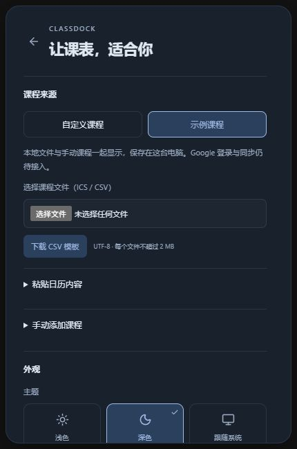
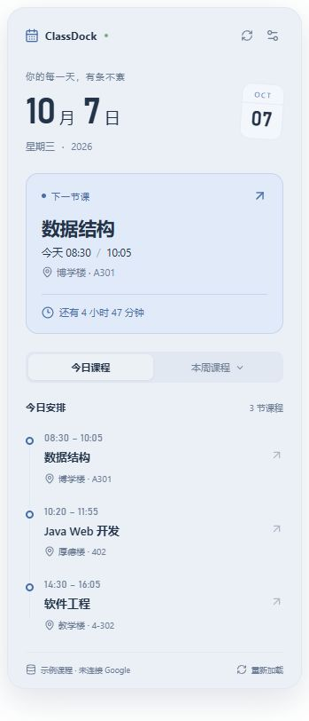

# ClassDock

轻量的 Windows 桌面课程表 Widget，使用 Tauri 2、React、TypeScript、Vite、Rust 和 Luxon。支持 Google 账号登录、选择日历与自动同步，以及本地 ICS、CSV 导入和手动添加课程。

**当前版本：0.3.1。修复休眠唤醒后课程表固定位置丢失；支持 Google 桌面 OAuth 登录、日历选择与在线同步。** 无需凭证即可使用本地课表。界面底部明确标记当前课程来源。

## 导入自己的课程

1. 打开设置 → **课程来源**，选择 ICS 日历或 UTF-8 CSV 文件。
2. 查看课程数量、时间和忽略事件提示，点击 **导入并显示**。取消预览不会改动现有课程。
3. 也可以展开 **粘贴日历内容**，粘贴 ICS / CSV；或展开 **手动添加课程**，填写日期、时间、地点，可选择每周重复到截止日期。
4. 文件课程与手动课程合并显示；重启后保留。再次导入同名文件会替换该文件，其他来源保留。移除可撤销；如果已导入同名新版，撤销会拒绝覆盖新版。
5. **示例课程**与**自定义课程**可随时切换，切换不会删除保存的课程。原始文件在磁盘上更新后，需要重新导入。

CSV 可在设置中下载当天模板。Excel 编辑后，另存为 **CSV UTF-8** 再导入；本版不直接读取 XLSX 或学校专用课表格式。表头与示例：

```csv
课程名称,开始时间,结束时间,地点,备注
高等数学,2026-10-07 08:30,2026-10-07 10:05,A301,第一周
```

课程名称、开始时间、结束时间必填，地点与备注可选。时间支持系统当地时区的 YYYY-MM-DD HH:mm，或带偏移的 ISO 日期时间；英文表头支持 title,start,end,location,description。坏行会拒绝整个文件，并提示错误位置。

ICS 课程与内嵌时区年份限 1900–2100。ICS 支持带时间的课程、每日/每周/简单每月/每年重复、每周多星期、COUNT、UNTIL、EXDATE、RDATE 和单次调课/取消。重复课程按过去 7 天和未来 90 天展开，每天更新范围；非重复课程保留原始日期。全天事件与取消事件会被忽略并提示。复杂 BY* 组合、RANGE=THISANDFUTURE、RDATE 时间段、高频重复和复杂内嵌时区会明确拒绝；常见年度夏令时规则与 IANA 时区可用。

本地上限：每文件 2 MB、合计保存 3 MB、10 个文件、300 条手动课程、展开后 5000 节；单个 ICS 最多 2000 个事件、一次最多遍历 10000 个重复候选。手动重复课程跨度最长两年。保存失败不会更改原有数据。



## 截图



[查看深色预览](assets/screenshots/widget-dark.png)。以上为浏览器外观截图；原生窗口截图区域预留。

## 当前功能

- 无传统标题栏，圆角、半透明背景，默认宽度 360px；窗口高度适配内容，最高 780px。
- 当前日期、星期、今日课程数量、时间顺序、地点、结束状态。
- 下一节课 / 正在上课 / 剩余时间 / 明天课程 / 无课程状态。
- 周一到周日分组列表，课程内容内部滚动；顶部与底部固定，不产生页面级滚动条。滚动时显示细滚动条，停止 1.2 秒后隐藏。
- 深色、浅色、跟随系统；背景不透明度 55–100%。
- 拖动整个顶部或日期区域；锁定位置；始终置顶；设置持久化。
- 系统托盘：打开、重新加载课程、今日、本周、设置、退出。
- 收起到托盘、关闭主窗时隐藏；拖动结束后保存固定位置，启动、休眠唤醒和托盘显示时恢复；正常退出时再次保存。
- 独立设置窗口；仅前端预览时在当前页展示设置。
- Mock 每次加载按当前周生成课程；倒计时每 30 秒更新，窗口重新获得焦点时更新。
- Google 桌面账号登录、日历选择、分页获取课程、每 10 分钟后台同步、手动同步及离线缓存；与 ICS/CSV 和手动课程合并。

**后续待实现：** 托盘设置勾选状态、开机启动和提醒；Windows 原生 Acrylic 与 WorkerW 桌面嵌入尚未实现。

## 环境要求

- Windows 10 / 11，推荐 x64。
- Node.js 22.12+ 或 24 LTS，npm。
- Visual Studio / Build Tools：勾选“使用 C++ 的桌面开发”和 Windows SDK。
- Microsoft Edge WebView2 Evergreen Runtime。
- Rust MSVC 工具链。项目通过 `rust-toolchain.toml` 固定 1.97.1，包含 rustfmt 和 clippy。

参见 [Tauri Windows 前置要求](https://v2.tauri.app/start/prerequisites/)。不使用 Electron，不需要额外安装 Chromium。

## 安装与开发

在项目根目录打开 PowerShell：

```powershell
npm install
npm run tauri dev
```

首次运行会下载 Rust 依赖并编译，耗时取决于网络和机器。后续增量构建更快。Tauri 自动启动 Vite 的 `127.0.0.1:1420` 服务；不要同时启动另一份占用该端口的 Vite。

仅预览 UI：

```powershell
npm run dev
```

浏览器打开 `http://127.0.0.1:1420`。浏览器预览没有拖窗、置顶和托盘能力；它不是原生运行验证。

## 测试与构建

```powershell
npm run check
npm run format
cargo fmt --manifest-path src-tauri/Cargo.toml --check
cargo clippy --manifest-path src-tauri/Cargo.toml --locked -- -D warnings
npm run tauri build
```

产物：

- `src-tauri/target/release/classdock.exe`：应用程序，可直接启动；需要系统 WebView2。
- `src-tauri/target/release/bundle/nsis/ClassDock_0.3.1_x64-setup.exe`：中文 NSIS 安装程序。

无需安装包时：`npm run tauri build -- --no-bundle`。发布构建去掉控制台，优化体积；本版未配置代码签名。安装程序按 Tauri 默认机制处理缺失的 WebView2。代码和资源都在本地，生产前端无外部字体请求。

## Google 账号登录与导入

1. 在 [Google Cloud Console](https://console.cloud.google.com/) 创建或选择项目，启用 **Google Calendar API**。
2. 配置 OAuth 同意屏幕；处于测试状态时，将自己的 Google 账号添加为测试用户。
3. 创建 **Desktop app / 桌面应用** OAuth 客户端，下载 JSON。
4. 打开 ClassDock **设置 → Google 日历 → 配置 Google 登录**，导入 JSON，点击 **保存 OAuth 配置**。也可手动填写 Client ID 与签发的客户端密钥。
5. 点击 **登录 Google**，在系统浏览器完成账号选择与只读授权，回到设置选择日历，再点击 **导入所选日历**。
6. Google 课程与自定义课程合并显示。可立即同步、重新登录更换账号、退出连接；关闭主窗口到托盘后仍每 10 分钟同步。退出应用后停止同步。

不读取 `.env`，不需要将凭据写入源码。使用 PKCE S256、随机 state、127.0.0.1 随机回调端口，授权等待最多 3 分钟。只请求日历列表与事件读取权限；请求只获取所选日历，但 OAuth 读取权限涵盖账号可访问的日历。桌面流程见 [Google 官方文档](https://developers.google.com/identity/protocols/oauth2/native-app)。

Client 配置与 Refresh Token 保存在 Windows 凭据管理器；Access Token 仅在 Rust 内存中。Token 不返回前端、不写缓存或日志。下载的 OAuth JSON 请保存在仓库外，勿提交 Git。客户端密钥不是桌面应用可保密的秘密。

重复课程由 Google API 展开，获取范围为过去 8 天至未来 91 天，给界面过去 7 天/未来 90 天留时区余量。全天与取消事件忽略，异常事件提示计数。Google 最多 5000 节，合并后最多 10000 节，课程缓存最多 4 MB。选择新日历失败会保留旧日历；新账号连接使用不同缓存标识，旧账号缓存不会载入新连接。退出删除本机授权和 Google 缓存，保留 OAuth 配置与本地课程；撤销或文件清理失败会显示原因。

断网、权限撤销、API 配额或缓存保存失败时保留上次成功课程及时间并显示提示。普通读取在失败后等待约 10 分钟再自动重试，手动同步可以立即重试。需要重新授权时点击重新登录。授权和同步期间其他操作会提示忙碌，授权可主动取消。

0.3.0 已验证代码、模拟数据和 Windows 设置窗口；尚无用户 OAuth 配置，真实 Google 账号授权/API 联调需配置后完成。详细边界见 [Google 接入验证](docs/GOOGLE-OAUTH-0.3.0.md)。

## 项目目录

```text
src/
  components/       CourseCard / NextClass / TodaySchedule / WeekSchedule / SyncStatus
  hooks/            30 秒时钟 / 滚动条自动隐藏
  pages/            WidgetPage / SettingsPage
  services/         Provider 接口 / Mock / ICS 与 CSV / 时间判断 / 桌面桥接
  stores/           Zustand 日历、来源、本地课程与设置状态
  types/            原始 Google 事件 / CourseEvent / 设置
  utils/            事件解析
  App.tsx           主题与窗口路由
  styles.css        本地字体与浅深色设计变量
src-tauri/
  src/              lib.rs / main.rs / tray.rs / window.rs / position.rs / google.rs
  capabilities/     本地窗口最小权限
  icons/            应用与托盘图标
  tauri.conf.json   透明窗、CSP、NSIS
assets/             SVG 图标源
docs/               运行与验收记录
```

后续 auth / calendar / cache / settings / startup 按职责增添 Rust 模块，不把 Token 或网络逻辑放入 React。CalendarProvider 接口允许替换数据实现；其他 Widget 可复用领域与服务层，不需在本轮引入 Dashboard 框架。

## 时间规则与测试

- CourseEvent 使用带偏移的 ISO 字符串，避免 Date 序列化和缓存恢复歧义；Luxon 操作完整日期，不按字符串切割判断时间。
- 今日课程按本地 `[当天午夜, 下一日午夜)` 相交查询；跨日课程在两天可见，正好午夜结束不会计入第二日。
- 进行中的课程优先于未来课程；起始时刻算进行中，结束时刻不算。重叠课程默认显示开始最早的进行中课程。
- 周从周一开始。DST 按日历日计算，不假定每天固定 24 小时。
- Google 重复数据由 API 展开；本地 ICS 使用 ical.js，并对时区、截止、排除与例外时间统一按绝对时刻处理，复杂规则在迭代前验证。
- 测试覆盖今日排序、进行中、未来课、明天课、无课程、起止边界、跨天、午夜、UTC、本地时区、DST、周分组、重复实例、全天过滤和坏事件。

## 常见问题

**看不到任务栏图标？** 主窗口作为 Widget 默认跳过任务栏，使用系统托盘重新打开。点右上角收起或关闭主窗后仍在托盘运行；退出请用托盘“退出 ClassDock”。

**如何拖动？** 按住顶部任意空白、ClassDock 标识或日期区域即可拖动；刷新、设置和收起按钮仍正常点击。锁定后需在设置中关闭“锁定位置”。拖动结束后立即记录坐标，休眠唤醒、重启或从托盘显示会恢复。升级后若旧版没有保存到你需要的位置，请重新拖动一次，再按需锁定。显示器暂时断开时移到可见工作区，接回后恢复原位置。窗体不嵌入桌面 WorkerW，保持透明悬浮模式。

**怎么添加自己的课程？** 在设置中导入 ICS / CSV 或手动添加。示例数据随当前周生成，仅供预览。

**如何刷新？** 重新加载按钮会读取当前课程来源；使用 Google 时会强制同步。示例课程模式不请求 Google。

**Rust 提示缺少 std 或格式化程序？** 检查安装是否完整，项目固定工具链后运行 `rustup toolchain install 1.97.1 --profile minimal --component rustfmt --component clippy`，再重试。C++ 链接失败时检查 Windows SDK 和 MSVC 工作负载。

**1420 端口被占用？** 关闭本项目上一份 Vite；不要更改端口而忘记同步 `tauri.conf.json` 的 devUrl。

**为什么 Google 登录按钮不可用？** 需先保存桌面 OAuth 配置，并在 Windows 桌面应用中使用；浏览器仅用于界面预览。

## 隐私

无遥测。Google 网络请求仅由 Rust 发往固定 Google HTTPS 端点，授权使用系统浏览器；课程备注按文本显示。Google 课程缓存包含个人日程，退出连接会清理；本地文件原文和手动课程保存在 WebView 本地存储，移除来源可清理对应课程。请保留原始文件，清除应用数据会丢失本地课表。主窗口固定位置独立保存在应用配置目录的 widget-position.json；仅记录坐标，不含课程或账号信息。旧版 window-state 位置会自动迁移。

## 验收记录

见 [位置恢复 0.3.1](docs/FIXES-0.3.1.md)、[Google 0.3.0](docs/GOOGLE-OAUTH-0.3.0.md)、[本地导入 0.2.0](docs/LOCAL-IMPORT-0.2.0.md)、[第一轮验收](docs/VALIDATION.md)、[窗口与滚动修复](docs/FIXES-0.1.1.md) 和 [设置窗口修复](docs/FIXES-0.1.2.md)。真实 Google 登录需要用户 OAuth 客户端和浏览器授权，不能用模拟测试宣称真实账户联调成功。
